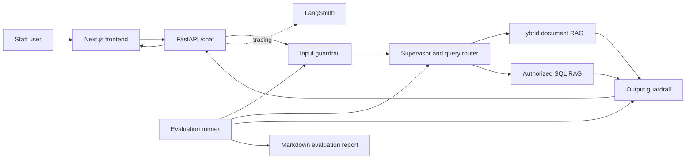

# MediBot architecture and dependency guide

These diagrams describe the implementation in `src/` as it currently exists.
They are split by stage so each flow can be read on its own.

## Stage flowcharts

1. [Document ingestion and Qdrant indexing](ingestion.md)
2. [API, authentication, and request guardrails](api_guardrails.md)
3. [Document retrieval, reranking, and answer agents](document_rag.md)
4. [Authorized SQL question path](sql_rag.md)
5. [Evaluation runner and report](evaluation.md)
6. [LangSmith tracing and structured logs](observability.md)

## Package analysis

[Python and frontend package inventory](packages.md) maps each declared
dependency to its role in the application and calls out requirements that do
not appear to be used by the current source.

## Request overview

The diagrams show the architecture and control flow. For exact behavior and
configuration, the linked source files remain authoritative.
