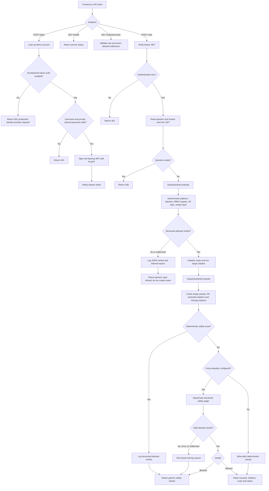

# API, authentication, and request guardrails

Source: `src/api/main.py`, `src/api/auth.py`, `src/guardrails/input.py`, and
`src/guardrails/output.py`.

Demo accounts are development-only and require a private password from `.env`.
Login and chat have request size, field length, and per-process rate limits;
production deployments must also configure equivalent limits at the edge.
The input guardrail is deterministic. OpenEvals is used by the output
guardrail when `GROQ_API_KEY` is configured; provider failures and malformed
verdicts block the response. Internal reasons go to application logs, while
the API returns generic safe messages.
