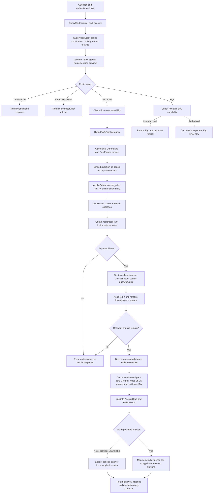

# Document retrieval, reranking, and answer agents

Source: `src/retrieval/router.py`, `hybrid_rag.py`, `reranker.py`,
`src/agents/supervisor.py`, `document.py`, `contracts.py`, and
`src/ingestion/vectorstore.py`.

The role filter is applied in Qdrant before results are returned to the answer
agent. The document model cannot create citation metadata; valid evidence IDs
are mapped to source records already selected by the application.
