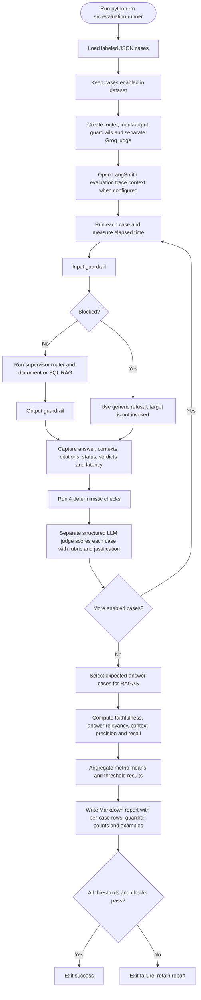

 # Evaluation pipeline and report generation

Source: `src/evaluation/runner.py`, `dataset.json`, guardrails, router, and
`reports/evaluation_latest.md`.

The report evaluates only enabled cases, while the JSON file may contain more
labeled cases. Refusal cases are judged and checked heuristically; RAGAS is
run on cases whose expected action is `answer`. The judge call is separate
from the chatbot response call, even though both use the configured Groq
model.
