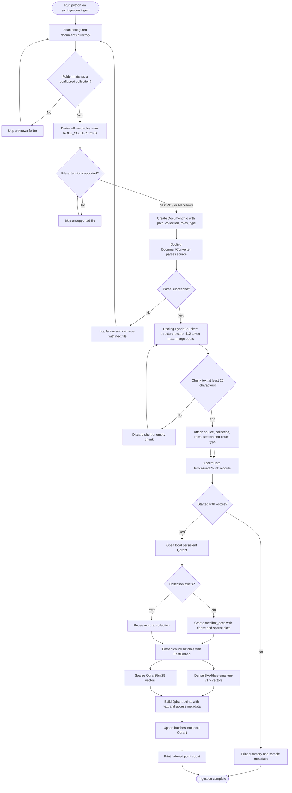

# Document ingestion and Qdrant indexing

Source: `src/ingestion/document_loader.py`, `ingest.py`, and `vectorstore.py`.

`--store` is required to write to Qdrant; without it the script parses and
chunks documents and prints a preview only. Collection access metadata is
derived from the role/collection policy in `src/config.py`.
