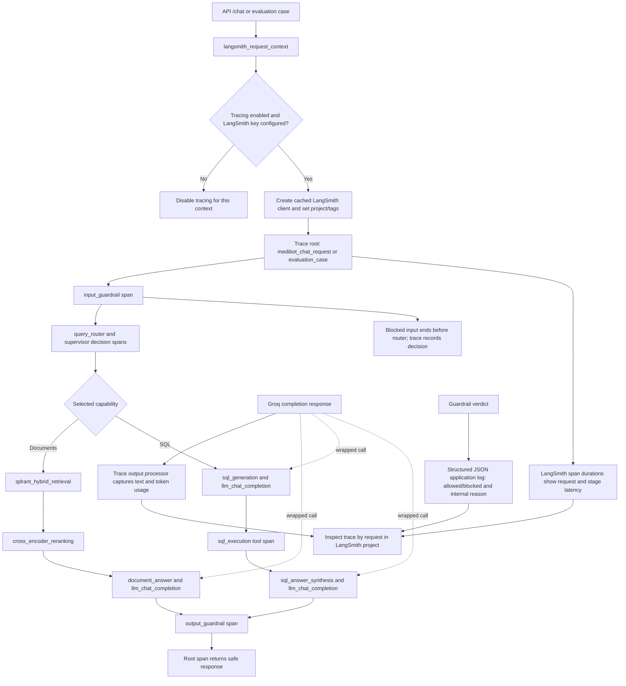

# LangSmith tracing and structured logs

Source: `src/observability/tracing.py`, API, agents, retrieval, guardrails,
and evaluation modules.

When tracing is disabled or the LangSmith API key is absent, the application
continues with tracing disabled. Guardrail decisions are also written as
structured JSON log events. Groq token counts appear when the provider returns
usage data; span durations provide request and stage timing.
