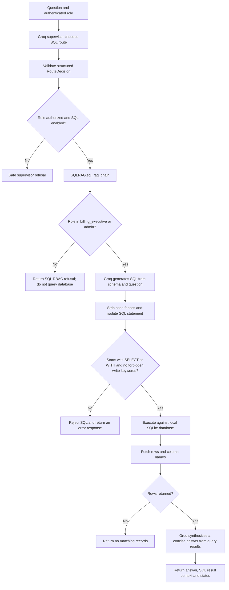

# Authorized SQL question path

Source: `src/agents/supervisor.py`, `src/retrieval/router.py`, and
`src/retrieval/sql_rag.py`.

SQLite execution is separate from the LLM: the generated query is checked by
`clean_sql` before it runs. Evaluation-only result context is attached
internally and omitted from the public `/chat` response.
